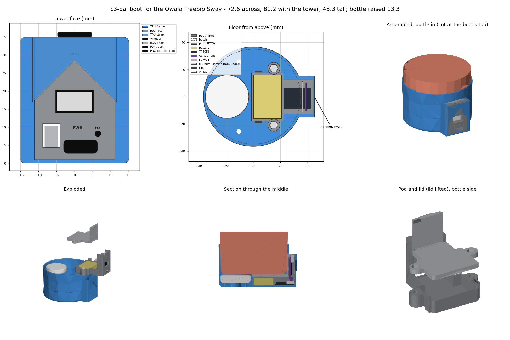
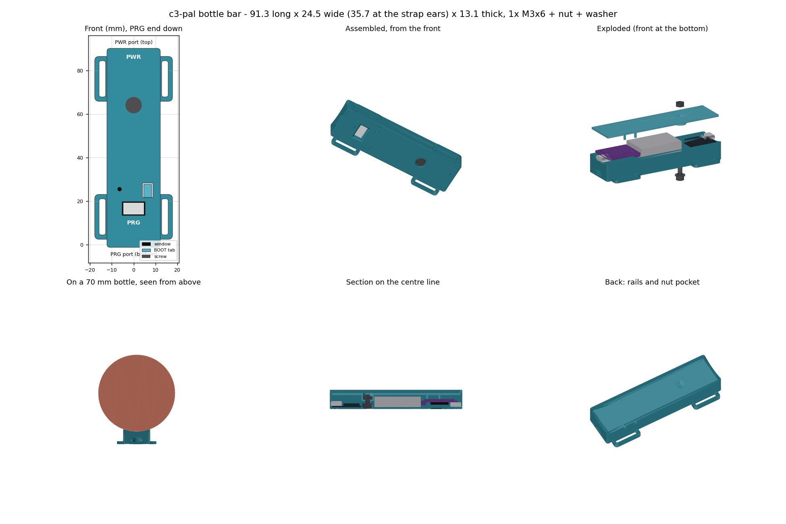

# c3-pal

A hydration buddy built on an ESP32-C3 board with a 0.42" OLED. Press BOOT
when you drink; a water droplet on the screen drains until the next drink is
due, then the screen flashes.

It comes in two printed forms, both generated with
[CadQuery](https://github.com/CadQuery/cadquery):

| Bottle boot (TPU boot + PETG pod) | Strap-on bar (PETG) |
|---|---|
|  |  |

## What's here

- `firmware/`: PlatformIO project (Arduino, U8g2).
- `boot/`: a TPU boot for the bottom of an Owala FreeSip Sway 30 oz. The
  electronics sit in a rigid PETG pod pressed into the boot, next to an AirTag
  pocket. Based on [owala-boots](https://github.com/cmpsamurai/owala-boots).
- `enclosure/`: a flat bar worn upright on the side of a 68 to 80 mm bottle
  with two velcro straps.

## Parts

- ESP32-C3 board with 0.42" OLED
- Mini TP4056 USB-C charger
- LP702030 350 mAh LiPo
- Wiring: battery to TP4056 B+ / B-; TP4056 OUT+ / OUT- to the C3's 5V / GND
  pads.

## Print it

- **Boot:** `boot/c3pal_boot.3mf` (TPU 90A) and `boot/c3pal_pod.3mf` (PETG),
  set up for a Bambu Lab A1. The full-resolution boot STL is about 100 MB, so
  it's on the [Releases page](../../releases); the pod and lid STLs are in
  `boot/`.
- **Bar:** `enclosure/c3pal.3mf` (PETG, front and back on one plate), or the
  STLs `c3pal_base.stl` and `c3pal_lid.stl`.
- Fit-test pieces for both are in each `fit_test/` folder.

## Build

Firmware, from `firmware/`:

```bash
python -m platformio run -t upload            # bar
python -m platformio run -e boot -t upload    # boot (screen turned 180°)
```

The chip sleeps between checks and USB serial stops while it sleeps: tap RST
and upload within a few seconds.

Models, from `enclosure/` or `boot/` (the boot uses the bar's requirements):

```bash
python -m venv venv
venv\Scripts\pip install -r requirements.txt
venv\Scripts\python generate.py
venv\Scripts\python make_3mf.py
```

All lengths are in mm.

Not affiliated with or endorsed by Owala.

## License

[MIT](LICENSE)
